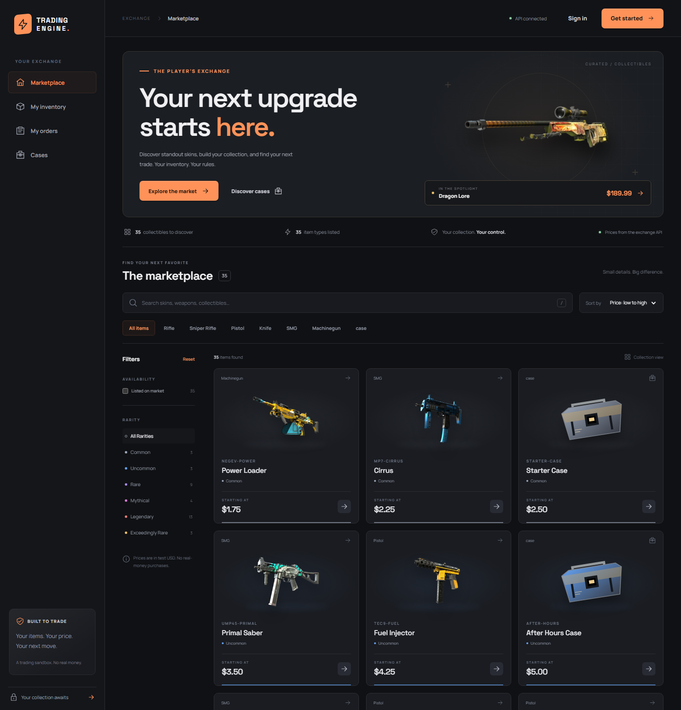
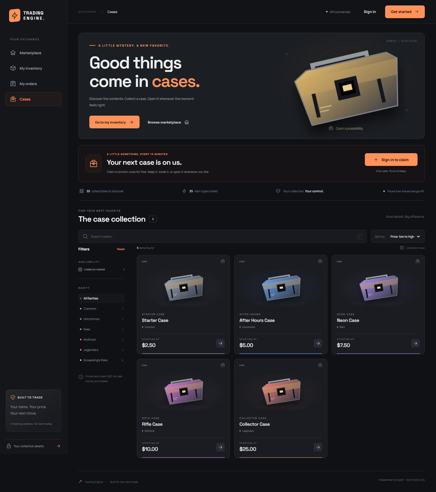
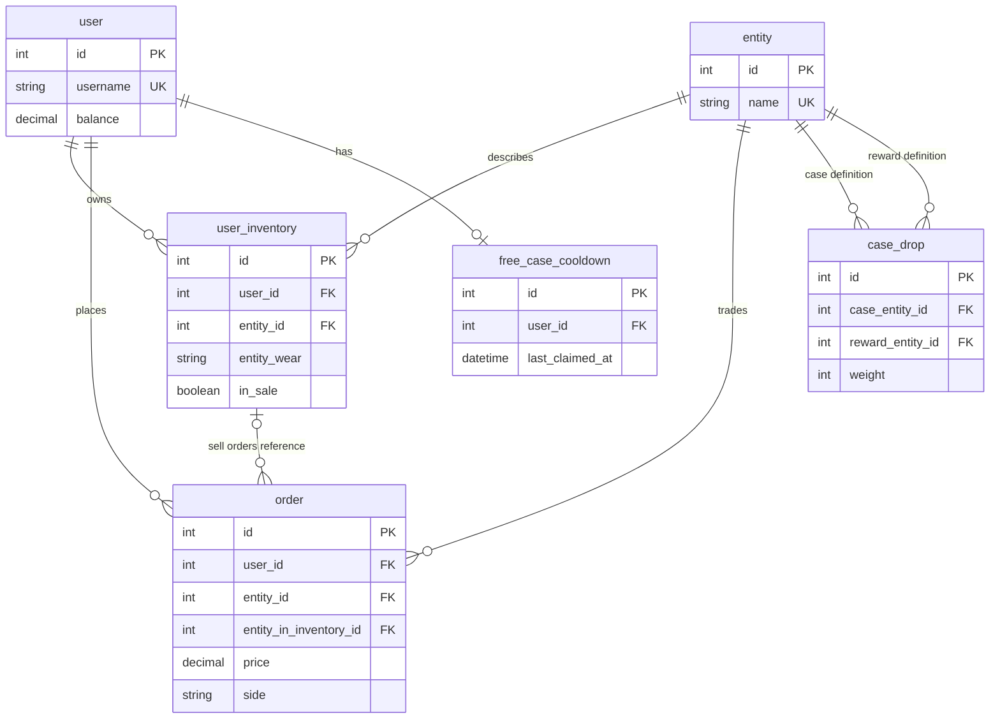

# Trading Marketplace

I got the idea from CS:GO skins and, to some extent, crypto and stock markets. I wanted to build something difficult: a project involving database design, transactions, ACID properties, and concurrency between users. My motivation was to see how far I could go building and architecting the backend myself.



*Screenshots use sample data. A fresh installation includes a demo market.*

<details>
<summary>Cases view</summary>



</details>

## About the project

The result is a marketplace where users own items, place buy and sell orders, and trade with each other. Compatible orders match automatically:

- A buy order matches the lowest eligible sell price; a sell order matches the highest eligible buy price.
- When prices are equal, orders with earlier creation times have priority.

Cases are also tradable items: users can keep them in their inventory, sell them, or open them later. Each case has a configurable drop table with weighted rewards, and users can claim a free case every 15 minutes.

Completed trades are recorded in history, including the buyer, seller, item, wear, and paid price. The history entry commits or rolls back together with the trade.

Accounts use virtual test balances, and the items are not connected to Steam.

## What I learned

The most interesting part for me was keeping the data consistent. Buying an item means updating both users’ balances, transferring ownership, and removing the completed order. These changes need to happen in one transaction. If something fails halfway through, the operation should roll back.

I had to think about what happens when two requests arrive at the same time. I also had to consider cases like users trying to buy their own listings, sell items they don't own, or purchase an item that has already been sold. That pushed me to learn about isolation levels, locking, database constraints, and transaction boundaries. Concurrency is still something I’m improving, especially around case operations.

The backend uses FastAPI, SQLAlchemy, and SQLite, with Alembic for migrations. I also learned why `Decimal` is important for prices and balances, how N+1 queries affect performance, and how to organize a growing backend.

## Database design

One decision I made was to separate catalog items from the copies users actually own. The catalog describes an item type, while each inventory entry has its own owner, wear, and listing status. I also decided to treat cases as items in the same catalog, with a separate table describing their possible rewards. This lets cases use the existing inventory and order system instead of needing a separate trading implementation.

The main tables are shown below. Categories and some columns are left out to keep the diagram readable.



Sell orders point to a specific inventory item. Buy orders point to the item type the user wants to buy.

## Development

I designed and wrote the core backend myself. I used AI for code cleanup advice, explanations of transactions and library usage, and examples that helped me implement things myself. It also helped with some fixes, migrations, and additional tests. My goal was to understand the decisions and work through the difficult parts myself.

I built the first frontend prototype myself, but I wasn’t happy with how it looked. I later rebuilt it with AI assistance to improve the design and connect the interface to the API. The frontend uses React, TypeScript, and Vite.

## Running locally

These commands use Windows PowerShell. The development setup is Python 3.13 and Node.js 22, with Git and npm installed.

### Setup

```powershell
git clone https://github.com/RamizP/FastApi.git
cd FastApi
python -m venv venv
.\venv\Scripts\python.exe -m pip install -r requirements.txt
npm --prefix trading-engine-frontend ci
Copy-Item src/.env.example src/.env
```

Generate a key, then paste it into `SECRET_KEY` in `src/.env`:

```powershell
.\venv\Scripts\python.exe -c "import secrets; print(secrets.token_hex(32))"
```

The commands below use the [Makefile](Makefile). If you don't use Make, expand "Running without Make" below.

<details>
<summary>Install Make on Windows</summary>

```powershell
winget install --id ezwinports.make --exact --source winget --scope user
```

Open a new terminal after installation. If your editor's terminal still cannot find `make`, restart the editor too.

</details>

### Start

From the project root, create the database and start the backend:

```powershell
make migrate
make backend
```

In another terminal, also from the project root:

```powershell
make frontend
```

Open [http://localhost:5173](http://localhost:5173). API docs are at [http://127.0.0.1:8000/docs](http://127.0.0.1:8000/docs). The frontend forwards `/api` to the backend on port `8000`.

Run `make` to list the available commands. It uses the root `venv` automatically.

<details>
<summary>Running without Make</summary>

After the setup above, run these commands from the project root:

```powershell
cd src/v1
..\..\venv\Scripts\python.exe -m alembic upgrade head
cd ../..
.\venv\Scripts\python.exe -m uvicorn main:app --app-dir src/v1 --reload
```

Start the frontend in another terminal at the project root:

```powershell
cd trading-engine-frontend
npm run dev
```

For tests and checks, run these from the project root. Browser tests need Chromium installed as described below.

```powershell
.\venv\Scripts\python.exe -m pytest -q
npm --prefix trading-engine-frontend run lint
npm --prefix trading-engine-frontend run build
npm --prefix trading-engine-frontend run test:e2e
```

</details>

### Try the demo

The application uses `src/v1/demo.db` by default. No environment commands are needed to select the demo. You can override the database with `DATABASE_URL` in `src/.env`. Local database files are ignored by Git.

On the first startup of an empty database, the backend adds 30 skins, 5 cases with rewards, and 10 demo traders with different inventories and balances. They have 70 sell listings and 70 buy orders between them.

There is also a guest account with $1,000 in virtual funds, five skins, and three cases:

| Username | Password |
| --- | --- |
| `guest` | `GuestDemo123!` |

Sign in as `guest` to buy a listing, sell an inventory item into an existing buy order, or open one of your cases. You can also register your own account and use the test-funds and test-inventory tools. Prices are sample values for the demo, not real market prices.

The demo is added once. Restarting keeps your trades and balances as they are. Databases that already have data are left alone. Set `DEMO_DATA=false` in `src/.env` before the first startup if you want an empty database instead. These are shared demo credentials for a local sandbox.

To add your own catalog items or cases, see the [catalog setup guide](docs/catalog-setup.md).

For other frontend API addresses, see the [frontend README](trading-engine-frontend/README.md). For future database changes, see the [migration instructions](src/v1/alembic/README).

## Running tests

From the project root:

```powershell
make test
make lint
make build
```

Backend tests cover authentication, ownership, order matching, failed-trade rollbacks, case opening, cooldowns, and migrations on an empty database.

History tests check that successful trades are recorded, failures roll back, and opening a traded case preserves its history.

For browser tests, install Chromium once:

```powershell
cd trading-engine-frontend
npx playwright install chromium
cd ..
```

Then run:

```powershell
make test-e2e
```

Browser tests run the main flows on desktop and mobile, including purchases, order cancellation, case opening, and recovery from API errors.

Tests use separate databases and leave application data alone. Browser tests start their own servers on ports `8765` and `5174`; those ports need to be free.
